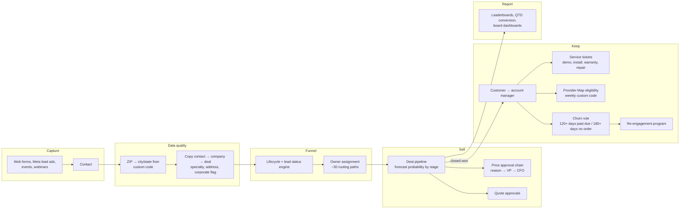

# HubSpot RevOps System

The architecture and core logic of a complete HubSpot revenue operations system I built and run for a medical device + consumables company. It covers lifecycle, routing, approvals, service, data quality and reporting, from first form fill to churn.

> **About this repo.** The real portal has **700+ workflows (400+ active)** across contacts, companies, deals, tickets and quotes. I can't publish the portal, so this repo does two things: it documents how the system is designed, and it rebuilds the four most important engines as tested Python with **synthetic data**. Rep names, approvers, pricing thresholds and customer data are all replaced.

## The system at a glance



## What's in this repo

| Module | Production workflow it mirrors | What it shows |
|---|---|---|
| [`revops/lifecycle.py`](revops/lifecycle.py) | Lifecycle stage + lead status engine (the portal's busiest workflow, **370K+ enrollments**) | Priority-ordered rules, forward-only stages, churn rule, internal/consumer exclusion, "notify, don't guess" |
| [`revops/assignment.py`](revops/assignment.py) | Contact, company and deal assignment for new business and for customers | ZIP-first then state fallback, outside vs inside eligibility, manual-handoff lock, corporate east/west, re-engagement owner |
| [`revops/approvals.py`](revops/approvals.py) | Four-workflow discounted price approval chain | A state machine across workflows; bundled consumables count toward price; idempotent steps |
| [`revops/service.py`](revops/service.py) | Ticket status, ship gate and stage reminders | Required fields before shipping, 2-day / 7-day nudges, demo auto-assignment |

Related repos built from the same portal:

- [hubspot-zip-data-quality](https://github.com/vrutikadani/hubspot-zip-data-quality): the custom-code address fixer
- [crm-automation-toolkit](https://github.com/vrutikadani/crm-automation-toolkit): Provider Map workflow and AR triage agent
- [territory-optimizer](https://github.com/vrutikadani/territory-optimizer): territory design behind the routing tables

## Design principles

1. **One workflow, one job, one owner prefix.** `OPS_` for data and routing, `SALES_` for deals and approvals, `SERVICE_` for tickets, `LEADS_` for campaigns. See [docs/naming-standard.md](docs/naming-standard.md).
2. **Routing tables are data.** A territory change edits a ZIP or state map. It doesn't add branches.
3. **Rebuild, don't patch.** When routing logic gets messy, I clone it into a dated clean rebuild ("Contact Assignment (Oct 2026)"), test it, then retire the old one.
4. **Humans win.** A manual owner handoff is locked so automation never overwrites it.
5. **Forward-only lifecycle.** Stages only move up. Churn changes customer type, not stage, so funnel reports stay honest.
6. **Notify, don't guess.** When no rule matches, the owner gets a task instead of a silent default.
7. **Logic in code where it's hard.** Address cleanup and Provider Map eligibility run as custom code with dry-run modes. Simple branching stays in the visual editor.

## Run it

```bash
pip install pytest
python -m pytest -q     # 18 tests
```

## Scale (production portal)

| | |
|---|---|
| Workflows built | 700+ (400+ active) |
| Objects automated | Contacts, companies, deals, tickets, quotes |
| Lifecycle engine enrollments | 370K+ |
| Contact routing paths | ~30 (ZIP and state, outside and inside) |
| Integrations | E-commerce, ERP, Google Sheets leaderboards, lead ads, CRM migration to Salesforce |

---
Built by [Vrutik Adani](https://www.linkedin.com/in/vrutikadani) · GTM Systems & AI Engineering
